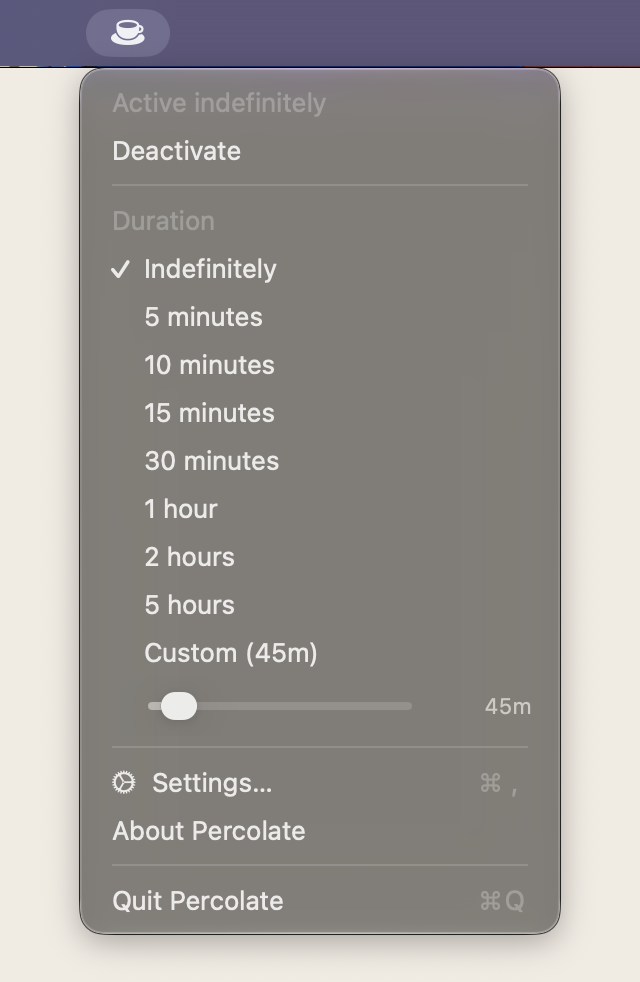
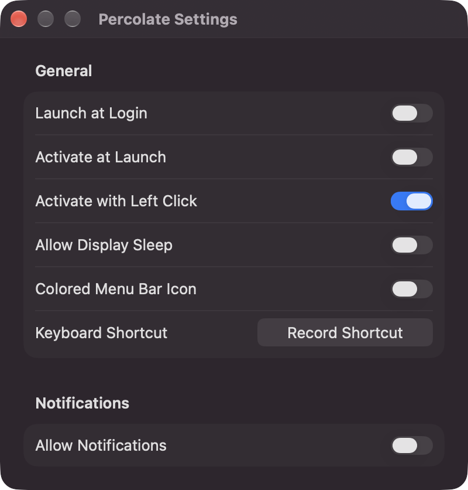

# Percolate ☕

**A free, open-source alternative to paid keep-awake apps like Caffeinated and Amphetamine.**

Percolate is a tiny menu bar app that keeps your Mac awake, now with a Windows version in
preview. No subscription, no in-app purchases, no tracking, no account. Every feature is free,
and each app is under 1,000 lines of code you can read in an afternoon.

Click the coffee cup to toggle. Right-click (or ⌃-click) to pick how long.

<p align="center">
  
  &nbsp;&nbsp;
  
</p>

## Why

Keeping a computer awake is one system call. It shouldn't cost a subscription. Percolate exists so
there's always a free option that matches the paid ones feature for feature. If it pushes them
to get better or cheaper, good. Everyone wins.

## Install

### macOS (13 Ventura or later)

1. Download `Percolate-macOS.zip` from the [latest release](https://github.com/srujyama/percolate/releases/latest)
   and unzip it.
2. Drag `Percolate.app` into `/Applications`.
3. Percolate isn't notarized by Apple yet, so macOS will say it "can't be opened" or "is damaged".
   That's Gatekeeper reacting to an unsigned download, not a problem with the app. Fix it once
   with:

   ```sh
   xattr -dr com.apple.quarantine /Applications/Percolate.app
   ```

   Or: try to open it, then go to **System Settings → Privacy & Security** and click **Open Anyway**.

### Windows 10 / 11 (preview)

1. Download `Percolate-Windows-x64.zip` from the [latest release](https://github.com/srujyama/percolate/releases/latest)
   (`arm64` for Snapdragon / ARM PCs), unzip it, and put `Percolate.exe` wherever you like.
2. Windows SmartScreen may say "Windows protected your PC" because the app isn't code-signed yet.
   Click **More info → Run anyway**.
3. Windows hides new tray icons behind the **^** arrow. To keep the cup visible, open
   **Settings → Personalization → Taskbar → Other system tray icons** and turn Percolate on.

The Windows version is a single self-contained `.exe` (no .NET install needed). Left-click the cup
to toggle, right-click for durations and settings. It has the same durations, Allow Display Sleep,
battery triggers, notifications and Launch at Startup as the Mac app, plus:

- **Global shortcut:** Ctrl+Alt+P (turn it on under Settings).
- **Command line**, for scripts and Task Scheduler: `Percolate.exe --on 30`, `--on` (indefinitely
  or the selected duration), `--off`, `--toggle`. Commands go to the running copy.
- It uses `SetThreadExecutionState`, the standard Windows keep-awake API. Check it with
  `powercfg /requests`.

Don't want to trust a binary? [Build it yourself](#build). It takes about a minute.

## Features

- **One-click toggle** from the menu bar. The cup fills while Percolate is active.
- **Durations:** indefinitely, 5/10/15/30 min, 1/2/5 h, or a custom slider (5 min – 12 h).
  The menu shows *"Active until 3:45 PM"* while a timer is running.
- **Allow Display Sleep:** keep the Mac running (downloads, builds) but let the screen turn off.
- **Battery triggers** (laptops): activate when the charger connects, deactivate when it
  disconnects, deactivate when the battery drops below 20%.
- **Global keyboard shortcut** to toggle from anywhere. No Accessibility permission needed.
- **Launch at Login** and **Activate at Launch**.
- **Notifications** on activate, deactivate, timer end and battery events (optional).
- **Colored menu bar icon** (optional).
- **Shortcuts app / Siri:** *Toggle*, *Activate* (with optional minutes) and *Deactivate* actions.
- **AppleScript:**
  ```applescript
  tell application "Percolate" to toggle
  tell application "Percolate" to turn on for 30   -- minutes; 0 = indefinitely
  tell application "Percolate" to turn off
  tell application "Percolate" to is active
  ```
- **URL scheme:** `open "percolate://on?minutes=30"`, `percolate://off`, `percolate://toggle`,
  `percolate://settings`

## How it works

Percolate holds an IOKit power assertion (`IOPMAssertionCreateWithName`):
`PreventUserIdleDisplaySleep` normally, or `PreventUserIdleSystemSleep` when "Allow Display
Sleep" is on. It's the same mechanism as the built-in `caffeinate` command. You can see it in
`pmset -g assertions`. Quitting the app releases the assertion.

## Build

### macOS

Requires macOS 13+, Xcode 15+ and [XcodeGen](https://github.com/yonaskolb/XcodeGen).

```sh
brew install xcodegen
./build.sh                 # → build/Percolate.app
open build/Percolate.app
```

Run `xcodegen generate` to open the project in Xcode instead. All icons (macOS and Windows) are
drawn by `python3 scripts/make-icons.py`.

### Windows

Requires the [.NET 8 SDK](https://dotnet.microsoft.com/download/dotnet/8.0). It builds on Windows,
macOS or Linux, but only runs on Windows.

```sh
dotnet build windows/Percolate                       # quick compile check
dotnet publish windows/Percolate -c Release -r win-x64 --self-contained true \
  -p:PublishSingleFile=true -p:EnableCompressionInSingleFile=true -o build/windows-x64
```

## Layout

macOS sources are in `Percolate/Sources/`; Windows sources are in `windows/Percolate/`, with one
file per macOS counterpart where there is one.

| macOS | Windows | Role |
|---|---|---|
| `AwakeController.swift` | `AwakeController.cs` | keep-awake request and duration timer |
| `StatusBarController.swift` | `TrayApp.cs` | menu bar / tray icon, clicks and menu |
| `BatteryMonitor.swift` | `PowerMonitor.cs` | power-source changes and battery triggers |
| `HotKey.swift` | `HotKey.cs` | global keyboard shortcut |
| `Notifier.swift` | `Notifier.cs` | notifications |
| `Preferences.swift` | `Settings.cs` | persisted settings |
| `LoginItem.swift` | `LoginItem.cs` | launch at login / startup |
| `Intents.swift` | | Shortcuts / App Intents |
| `Scripting.swift` + `Percolate.sdef`, URL scheme | `Program.cs` | AppleScript and `percolate://` / command line |
| `Windows.swift` | `TrayApp.cs` (dialogs) | Settings, Welcome and About |

## Releasing

Every push builds both apps and runs a Windows smoke test (launch, `--on`, check
`powercfg /requests`, `--off`). Push a tag (`git tag v1.1.0 && git push --tags`) to also publish a
release with `Percolate-macOS.zip`, `Percolate-Windows-x64.zip` and `Percolate-Windows-arm64.zip`.

## Contributing

Issues and pull requests are welcome. Missing a feature from a paid app? Open an issue.

## License

MIT. See [LICENSE](LICENSE).

Percolate is an independent project and isn't affiliated with Caffeinated, Amphetamine or their
developers. Those names belong to their owners.
